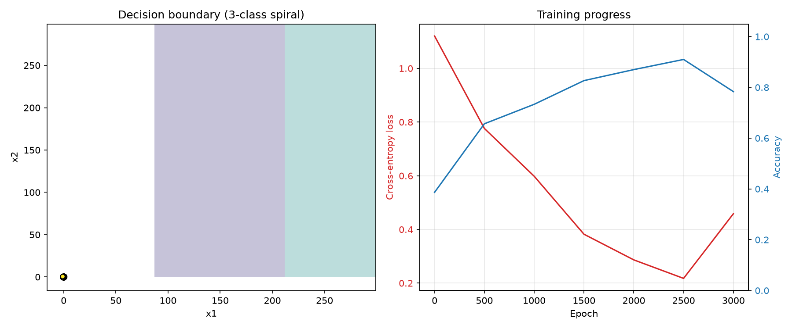

# Neural Network from Scratch (NumPy)

A small multilayer perceptron (MLP) implemented using **only NumPy**, with no deep learning framework and no automatic differentiation. The forward pass, loss, backpropagation and gradient descent are all written by hand, to show how neural networks learn at the lowest level.

## Features

- Fully connected network with configurable layer sizes
- `tanh` activation in hidden layers
- Softmax output layer with cross-entropy loss
- Manual backpropagation and gradient descent
- Two demo problems: XOR and a three-class spiral

## Installation and usage

```bash
pip install numpy
python nn_from_scratch.py
```

To build a network, pass the layer sizes:

```python
net = MLP([2, 45, 45, 3])  # 2 inputs, two hidden layers of 45 neurons, 3 classes
net.fit(X, y, epochs=3000, lr=1.0)
predictions = net.predict(X)
```

## Demos
### 1. XOR

XOR is the classic problem that a single neuron cannot solve, because the classes are not linearly separable. A network with one hidden layer learns it.

| Epoch | Loss | Accuracy |
|---|---|---|
| 0 | 0.7053 | 50% |
| 500 | 0.0046 | 100% |
| 1000 | 0.0018 | 100% |
| 1500 | 0.0011 | 100% |
| 2000 | 0.0008 | 100% |

Final predictions: `[0 1 1 0]` (expected `[0 1 1 0]`)

### 2. Three-class spiral
A harder, non-linear classification problem with three interleaved spiral arms.

| Epoch | Loss | Accuracy |
|---|---|---|
| 0 | 1.0915 | 34.3% |
| 500 | 1.0176 | 47.0% |
| 1000 | 0.7432 | 68.0% |
| 1500 | 0.4790 | 78.0% |
| 2000 | 0.3301 | 85.7% |

Final training accuracy: **85.7%**



<details>
<summary>Raw console output</summary>

```
== XOR (the classic problem a single neuron cannot solve) ==
epoch     0 | loss 0.7053 | accuracy 0.5000
epoch   500 | loss 0.0046 | accuracy 1.0000
epoch  1000 | loss 0.0018 | accuracy 1.0000
epoch  1500 | loss 0.0011 | accuracy 1.0000
epoch  2000 | loss 0.0008 | accuracy 1.0000
Predictions: [0 1 1 0], expected: [0 1 1 0]

== Three-class spiral ==
epoch     0 | loss 1.0915 | accuracy 0.3433
epoch   500 | loss 1.0176 | accuracy 0.4700
epoch  1000 | loss 0.7432 | accuracy 0.6800
epoch  1500 | loss 0.4790 | accuracy 0.7800
epoch  2000 | loss 0.3301 | accuracy 0.8567
Final accuracy: 0.8566666666666667
```

</details>

## How it works

1. **Forward pass:** each layer computes `inputs @ weights + bias`. Hidden layers apply `tanh`, and the output layer applies softmax to produce class probabilities.
2. **Loss:** cross-entropy measures how much probability the network assigned to the correct class.
3. **Backpropagation:** the error is propagated backwards through the layers using the chain rule. For softmax with cross-entropy, the output gradient simplifies to `probabilities - one_hot_labels`. The `tanh` derivative is `1 - tanh(x)^2`.
4. **Gradient descent:** each weight and bias is updated by a small step against its gradient, `W -= learning_rate * dW`.


## Limitations

- Small educational implementation: full-batch gradient descent only, no mini-batches, regularization or optimizers such as Adam.
- Slow compared with framework implementations and not suited to large datasets.
- The spiral result is training accuracy, not accuracy on unseen data.

## Possible improvements

- Train/test split to report generalization
- Decision boundary plot
- Numerical gradient check to verify backpropagation
- Mini-batch training and the Adam optimizer
- MNIST digit classification